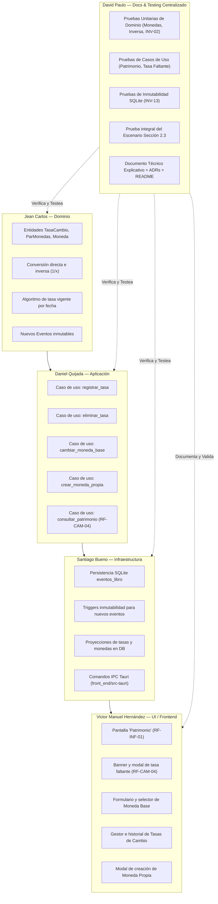
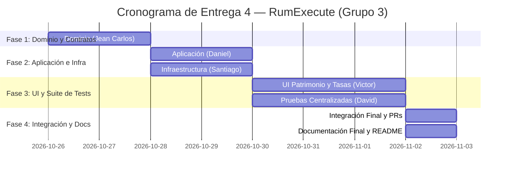

# Plan de Trabajo y Repartición de Tareas — Entrega 4: Manejo de Monedas y Tasas de Cambio (The Exchange Flow)

**Asignatura:** CI-3715: Ingeniería de Software (Universidad Simón Bolívar)  
**Equipo:** Grupo 3 — RumExecute  
**Proyecto:** *Cuentas Claras*  
**Integrantes:**
- Victor Manuel Hernández (20-10330) — Interfaz de Usuario (Frontend / Tauri Webview)
- Jean Carlos Sifontes — Capa de Dominio (Entidades, Value Objects e Invariantes)
- Daniel Quijada (20-10518) — Capa de Aplicación (Casos de Uso, DTOs y Orquestación)
- Santiago Bueno (20-10349) — Capa de Infraestructura (Event Sourcing SQLite y Comandos Tauri IPC)
- David Paulo (21-10475) — Documentación Técnica, README y **Suite Completa de Pruebas Automatizadas**

**Porcentaje de Evaluación:** 10% del Laboratorio  
**Alcance Normativo:** `RF-CAM-01`, `RF-CAM-02`, `RF-CAM-03`, `RF-CAM-04`, `RF-INF-01`, `RF-CAM-06` (básica)  
**Invariantes:** `INV-01`, `INV-02`, `INV-03`, `INV-13`, `INV-16`, `INV-18`  
**Restricciones de Calidad:** `RNF-08` (Aritmética decimal exacta), `RNF-12` (Event sourcing inmutable), `RNF-13` / `RNF-14` (Arquitectura hexagonal), `RNF-18` (Mensajes claros de error en español)

---

## 1. Directriz Estratégica del Equipo (Asignación de Pruebas y Responsabilidades)

Con el fin de maximizar la especialización del equipo, evitar duplicidad de esfuerzo y garantizar un testing riguroso e independiente:

> [!IMPORTANT]
> **POLÍTICA DE PRUEBAS DE LA ENTREGA 4 (CENTRALIZACIÓN):**  
> Los módulos de **Dominio**, **Aplicación**, **Infraestructura** e **Interfaz de Usuario** quedan **100% liberados de escribir tests automatizados**.  
> **David Paulo (Responsable de Documentación y Pruebas)** asumirá la **autoría completa y centralizada de toda la suite de pruebas automatizadas** de la Entrega 4 (`cargo test` con adaptadores en memoria y pruebas de integración con SQLite inmutable), asegurando la cobertura exhaustiva de los casos de uso, invariantes numéricas y el escenario de validación de la Sección 2.3 de la especificación.

---

## 2. Matriz de Repartición de Tareas por Integrante

---

### Integrante 1: Jean Carlos Sifontes
**Rol:** Arquitectura de Dominio, Value Objects, Reglas Matemáticas e Invariantes  
**Rama Git:** `feature/dominio-monedas-tasas`  
**Archivos objetivo:**
- `front_end/src-tauri/src/dominio/moneda.rs`
- `front_end/src-tauri/src/dominio/tasa_cambio.rs`
- `front_end/src-tauri/src/dominio/evento.rs`
- `front_end/src-tauri/src/dominio/mod.rs`

#### Responsabilidades Detalladas (Sin Tests):
1. **Entidad y Value Object de Moneda (`RF-CAM-01`):**
   - Extender el soporte de monedas para aceptar monedas propias además de las 4 de fábrica (`VES`, `USD`, `EUR`, `USDT`).
   - Validaciones estrictas de creación de moneda propia:
     - Código de 3 a 5 letras mayúsculas ASCII (`^[A-Z]{3,5}$`).
     - Nombre descriptivo (no vacío, 1 a 50 caracteres).
     - Símbolo (no vacío, 1 a 5 caracteres UTF-8).
     - Cantidad de decimales permitida: entero entre `0` y `8` inclusive.
     - Inmutabilidad de las monedas de fábrica: rechazar cualquier intento de sobreescribir o eliminar `VES`, `USD`, `EUR`, `USDT`.
2. **Entidad `TasaCambio` y Value Object `ParMonedas` (`RF-CAM-03`):**
   - Par de monedas ordenado `(origen, destino)` donde `origen != destino`.
   - Valor de la tasa (`Decimal`): estrictamente mayor a cero (`> 0`), con hasta 8 decimales de precisión.
   - Fecha de vigencia (`NaiveDate`): fecha en formato `YYYY-MM-DD`, que **no puede ser posterior a la fecha actual del sistema** (rechazar fecha futura con error `FechaInvalida`).
   - Fuente opcional/descriptiva (texto libre sanitizado).
3. **Lógica de Conversión e Invariantes (`INV-01`, `INV-02`, `INV-03`):**
   - Conversión directa: `MontoDestino = MontoOrigen * ValorTasa`.
   - Conversión inversa (`RF-CAM-03`): Si existe tasa registrada `A -> B`, la tasa `B -> A` se calcula matemáticamente como `1 / ValorTasa`.
   - **Prohibición de conversión cruzada o triangular:** Si se tiene `VES -> USD` y `EUR -> USD`, **no inventar** `VES -> EUR` a menos que exista explícitamente registrada.
   - Algoritmo de selección temporal: Dada una fecha de consulta $T$, la tasa vigente para el par $(A, B)$ es la tasa más reciente registrada con $\text{fecha\_vigencia} \le T$. Si no existe ninguna tasa en esa fecha o anterior, no existe tasa vigente.
   - Redondeo final exacto: Todo resultado final se redondea según los decimales de la moneda destino/base utilizando la estrategia bancaria estándar (`MidpointNearestEven` o truncamiento/redondeo según especificación).
4. **Definición de Nuevos Eventos Inmutables de Dominio:**
   - `MonedaCreada { codigo, nombre, simbolo, decimales, momento }`
   - `MonedaBaseCambiada { nuevo_codigo, momento }`
   - `TasaRegistrada { id, origen, destino, valor, fecha_vigencia, fuente, momento }`
   - `TasaEliminada { id_tasa, momento }`

---

### Integrante 2: Daniel Quijada
**Rol:** Capa de Aplicación, Casos de Uso, DTOs y Orquestación  
**Rama Git:** `feature/aplicacion-casos-de-uso`  
**Archivos objetivo:**
- `front_end/src-tauri/src/aplicacion/casos_de_uso/`
  - `registrar_tasa.rs`
  - `eliminar_tasa.rs`
  - `cambiar_moneda_base.rs`
  - `crear_moneda.rs`
  - `consultar_patrimonio.rs`
  - `listar_historial_tasas.rs`
- `front_end/src-tauri/src/aplicacion/puertos.rs`
- `front_end/src-tauri/src/aplicacion/dto.rs`

#### Responsabilidades Detalladas (Sin Tests):
1. **Caso de Uso `RegistrarTasa` (`RF-CAM-03`):**
   - Recibe DTO con `origen`, `destino`, `valor`, `fecha_vigencia`, `fuente`.
   - Valida existencia de ambas monedas en el catálogo del sistema.
   - Emite el evento inmutable `TasaRegistrada`.
2. **Caso de Uso `EliminarTasa` (`RF-CAM-06` básica):**
   - Recibe el `id` de la tasa a eliminar.
   - Verifica existencia de la tasa en el estado actual.
   - Emite el evento inmutable `TasaEliminada` (sin borrado físico).
3. **Caso de Uso `CambiarMonedaBase` (`RF-CAM-02`):**
   - Recibe el código de la nueva moneda base.
   - Valida que la moneda exista en el catálogo de monedas.
   - Emite el evento `MonedaBaseCambiada`.
   - Garantiza que los movimientos y saldos originales de las cuentas no se alteran.
4. **Caso de Uso `CrearMonedaPropia` (`RF-CAM-01`):**
   - Valida que el código no colisione con el catálogo de fábrica ni con monedas previamente creadas (*case-insensitive*).
   - Emite `MonedaCreada`.
5. **Caso de Uso `ConsultarPatrimonio` (`RF-INF-01`, `RF-CAM-04`):**
   - Recibe la `fecha_consulta` (opcional, por defecto fecha de hoy).
   - Obtiene todas las cuentas activas y proyecta sus saldos a la fecha de consulta.
   - Agrupa subtotales por moneda original.
   - Para cada moneda presente en las cuentas que difiera de la Moneda Base:
     - Busca la tasa vigente (directa o inversa) a la `fecha_consulta`.
     - **Regla Estricta `RF-CAM-04`:** Si falta una tasa para alguna moneda con saldo no nulo hacia la moneda base en esa fecha:
       - Retorna un resultado tipado estructurado que incluye:
         1. Las cuentas y subtotales en su moneda original.
         2. Un indicador de error `TasaFaltante` detallando: `moneda_origen`, `moneda_destino`, `fecha_requerida`.
         3. **Total consolidado en `None`** (estrictamente prohibido sumar monedas distintas sin tasa).
     - Si todas las tasas existen:
       - Convierte cada saldo a la moneda base.
       - Suma el total consolidado exacto con `rust_decimal`.
       - Redondea el total final a la cantidad de decimales de la moneda base.
       - Retorna el DTO de patrimonio consolidado exitoso.

---

### Integrante 3: Santiago Bueno
**Rol:** Capa de Infraestructura, Persistencia SQLite Inmutable y Comandos IPC Tauri  
**Rama Git:** `feature/infraestructura-sqlite-tauri`  
**Archivos objetivo:**
- `front_end/src-tauri/src/infraestructura/persistencia/sqlite.rs`
- `front_end/src-tauri/src/infraestructura/persistencia/migraciones.rs`
- `front_end/src-tauri/src/comandos.rs`
- `front_end/src-tauri/src/lib.rs`

#### Responsabilidades Detalladas (Sin Tests):
1. **Evolución del Schema SQLite y Event Sourcing Inmutable (`INV-13`, `RNF-12`):**
   - Mantener la tabla `eventos_libro` como fuente única de verdad.
   - Serializar y deserializar los nuevos payloads JSON para los eventos:
     - `MonedaCreada`, `MonedaBaseCambiada`, `TasaRegistrada`, `TasaEliminada`.
   - Garantizar inmutabilidad física: Triggers SQL `BEFORE UPDATE` y `BEFORE DELETE` sobre `eventos_libro` que aborten cualquier intento de mutación.
   - Replay de eventos: Reconstruir eficientemente el catálogo de monedas, las tasas vigentes e históricas, y la moneda base actual al iniciar o consultar.
2. **Exposición de Comandos Tauri IPC (`front_end/src-tauri/src/comandos.rs`):**
   - `#[tauri::command] registrar_tasa(origen, destino, valor, fecha_vigencia, fuente)`
   - `#[tauri::command] eliminar_tasa(id_tasa)`
   - `#[tauri::command] cambiar_moneda_base(nuevo_codigo)`
   - `#[tauri::command] obtener_moneda_base()`
   - `#[tauri::command] crear_moneda(codigo, nombre, simbolo, decimales)`
   - `#[tauri::command] listar_monedas()`
   - `#[tauri::command] listar_historial_tasas(origen, destino)`
   - `#[tauri::command] consultar_patrimonio(fecha_consulta)`
   - Manejo de errores amigables en español estructurados según `RNF-18`.
3. **Registro y enlace en `lib.rs`:**
   - Registrar todos los nuevos comandos en el builder de Tauri (`generate_handler!`).

---

### Integrante 4: Victor Manuel Hernández
**Rol:** Interfaz de Usuario (Frontend / Next.js, Tailwind CSS y Tauri Webview)  
**Rama Git:** `ui` (o `feature/ui-patrimonio-tasas`)  
**Archivos objetivo:**
- `front_end/src/app/page.tsx`
- `front_end/src/app/patrimonio/page.tsx` (o tab dedicado de Patrimonio)
- `front_end/src/components/patrimonio/`
  - `TablaPatrimonio.tsx`
  - `BannerTasaFaltante.tsx`
  - `SelectorFechaConsulta.tsx`
  - `SelectorMonedaBase.tsx`
- `front_end/src/components/tasas/`
  - `ModalRegistroTasa.tsx`
  - `HistorialTasas.tsx`
  - `ModalCrearMoneda.tsx`
- `front_end/src/services/tauri.ts`

#### Responsabilidades Detalladas (Sin Tests):
1. **Nueva Pantalla / Vista de "Patrimonio" (`RF-INF-01`):**
   - Navegación superior intuitiva: Pestaña "Cuentas" y Pestaña "Patrimonio".
   - Selector interactivo de **Fecha de Consulta** (por defecto la fecha actual).
   - Selector visible de **Moneda Base** actual con opción rápida de cambio (`RF-CAM-02`).
   - Tabla o tarjetas de cuentas mostrando: Nombre, Tipo, Saldo Original con su Moneda, Tasa aplicada a la fecha de consulta y Saldo Convertido en Moneda Base.
   - Bloque de **Subtotales por Moneda Original** (respetando `INV-02`).
   - Card destacada con el **Total Consolidado en Moneda Base** (redondeado a sus decimales correspondientes).
2. **Gestión y Alerta de Tasa Faltante (`RF-CAM-04`):**
   - Si la consulta de patrimonio indica tasa faltante:
     - Ocultar o deshabilitar el cálculo del Total Consolidado global.
     - Mostrar un **Banner de Alerta claro y visible**:  
       *"No se puede calcular el patrimonio consolidado al DD/MM/AAAA porque no existe una tasa de cambio registrada para [MONEDA_ORIGEN] a [MONEDA_DESTINO] en esa fecha o anterior."*
     - Botón de acción rápida en el banner: *"Registrar Tasa Ahora"*, abriendo directamente el modal con el par y la fecha preseleccionados.
3. **Módulo de Gestión de Tasas de Cambio (`RF-CAM-03`, `RF-CAM-06`):**
   - Formulario de registro de tasa: selectores de moneda origen y destino, input numérico para el valor (hasta 8 decimales), input de fecha (no futura) y campo de texto para la fuente.
   - Tabla de historial de tasas registradas por par, mostrando valor, fecha, fuente y botón para **Eliminar Tasa** (con confirmación modal amigable).
4. **Modal de Creación de Moneda Propia (`RF-CAM-01`):**
   - Formulario para registrar nueva moneda (Código 3-5 mayúsculas, Nombre, Símbolo, Decimales 0-8).
   - Bloqueo de edición de las 4 monedas de fábrica (`VES`, `USD`, `EUR`, `USDT`).

---

### Integrante 5: David Paulo
**Rol:** **Documentación Técnica, ADRs, README y SUITE COMPLETA DE PRUEBAS AUTOMATIZADAS (CENTRALIZADA)**  
**Rama Git:** `feature/docs-tests-entrega4`  
**Archivos objetivo:**
- `front_end/src-tauri/tests/` (Suite integral de pruebas)
  - `test_dominio_monedas_tasas.rs`
  - `test_invariantes_aritmética.rs`
  - `test_casos_uso_patrimonio.rs`
  - `test_escenario_seccion_2_3.rs`
  - `test_inmutabilidad_sqlite_entrega4.rs`
- `docs/Documento_Tecnico_Explicativo_Entrega_4.md`
- `docs/adr/ADR-005-manejo-tasas-cambio-patrimonio.md`
- `front_end/README.md` (Instrucciones de compilación, ejecución y verificación del caso de uso 2.3)

#### Responsabilidades Detalladas (Pruebas + Documentación):
1. **Suite Completa de Pruebas Automatizadas en Rust (`cargo test`):**
   *Al asumir la responsabilidad centralizada de pruebas, David Paulo diseñará y codificará los tests para todos los módulos:*
   - **Pruebas de Dominio e Invariantes:**
     - Validación de códigos de moneda (alfabéticos 3-5, rechazo de caracteres especiales, números o longitudes inválidas).
     - Validación de decimales de moneda (entre 0 y 8).
     - Inmutabilidad del catálogo de fábrica: intento de mutar `VES`, `USD`, `EUR` o `USDT` produce error.
     - Tasa de cambio: rechazo de tasa con valor $\le 0$, monedas iguales, o fecha futura respecto al reloj del sistema.
     - Tasa inversa: verificación de que si existe $A \to B$, la tasa inversa $B \to A = 1 / \text{valor}$ opera con precisión decimal exacta (`rust_decimal`).
     - Rechazo estricto de tasas cruzadas: verificar que $A \to B$ y $B \to C$ **no** calculan mágicamente $A \to C$ sin tasa explícita.
     - Cumplimiento de `INV-02`: sumar monedas distintas sin tasa registrada genera error explícito.
   - **Pruebas de Casos de Uso:**
     - Selección de tasa por fecha: dadas varias tasas históricas para un mismo par, verificar que se selecciona la más reciente con $\text{fecha} \le \text{fecha\_consulta}$.
     - Comportamiento ante eliminación de tasa: emite `TasaEliminada` y deja de ser seleccionada para conversiones.
     - Detección de tasa faltante (`RF-CAM-04`): verificar que si falta una tasa para una cuenta con saldo en moneda no base, el caso de uso no inventa número ni excluye la cuenta, reportando el par faltante y omitiendo el consolidado.
     - Cambio de Moneda Base: verificar que cambiar de USD a EUR o VES recalcula las proyecciones de patrimonio sin mutar cuentas ni movimientos.
   - **Prueba del Escenario Específico de la Sección 2.3 de la Cátedra:**
     - Reproducción exacta automatizada del caso de ejemplo provisto en la especificación oficial con cuentas en VES y USD, registrando tasas escalonadas y comprobando los totales consolidados a diferentes fechas.
   - **Pruebas de Inmutabilidad en SQLite (`INV-13`):**
     - Verificación de inserción de eventos `TasaRegistrada`, `TasaEliminada`, `MonedaCreada`, `MonedaBaseCambiada`.
     - Intento de ejecución de `UPDATE` o `DELETE` SQL sobre la tabla `eventos_libro` genera fallo por trigger.
     - Replay de eventos: reconstrucción exacta del estado tras reinicio de la base de datos.
2. **Documentación Técnica y Entregables Formales:**
   - Redacción de `Documento_Tecnico_Explicativo_Entrega_4.md` detallando la arquitectura, modelado de tasas temporales, cumplimiento de invariantes y manual de usuario.
   - Elaboración del `ADR-005` justificando la decisión de diseño de tasas directas/inversas, rechazo de tasas triangulares y persistencia por eventos.
   - Actualización del `front_end/README.md` con la guía paso a paso para ejecutar las pruebas (`cargo test`) y comprobar el flujo de patrimonio.

---

## 3. Matriz de Cobertura de Requerimientos e Invariantes

| Requerimiento / Invariante | Descripción | Responsable Implementación | Responsable Testing y QA |
| :--- | :--- | :--- | :--- |
| **`RF-CAM-01`** | Monedas propias y catálogo de fábrica inmutable | Jean Carlos (Dominio) / Daniel (App) / Victor (UI) | David Paulo |
| **`RF-CAM-02`** | Selección de Moneda Base del sistema | Daniel (App) / Victor (UI) | David Paulo |
| **`RF-CAM-03`** | Registro de Tasas de Cambio, fecha no futura y cálculo inverso | Jean Carlos (Dominio) / Daniel (App) / Victor (UI) | David Paulo |
| **`RF-CAM-04`** | Detección estricta de tasa faltante (sin totales inventados) | Daniel (App) / Victor (UI) | David Paulo |
| **`RF-INF-01`** | Pantalla de Patrimonio (Saldos originales, subtotales y consolidado) | Daniel (App) / Victor (UI) | David Paulo |
| **`RF-CAM-06`** (básica) | Historial de tasas y eliminación inmutable (`TasaEliminada`) | Jean Carlos (Dominio) / Santiago (Infra) / Victor (UI) | David Paulo |
| **`INV-01`** | Todo monto contiene cantidad y código de moneda indivisible | Jean Carlos (Dominio) | David Paulo |
| **`INV-02`** | Prohibido sumar monedas distintas sin tasa vigente | Jean Carlos (Dominio) / Daniel (App) | David Paulo |
| **`INV-03`** | Aritmética decimal exacta (`rust_decimal`), sin floats | Jean Carlos (Dominio) | David Paulo |
| **`INV-13`** | Event Sourcing inmutable e idempotente en SQLite | Santiago Bueno (Infraestructura) | David Paulo |
| **`INV-16`** | Local-first: cero llamadas a APIs externas de tasas | Todos (Garantía arquitectural) | David Paulo |

---

## 4. Cronograma de Integración y Flujo de Trabajo en Git

Para garantizar una integración fluida sin bloqueos:

### Reglas para los Pull Requests:
1. **Ramas derivadas de `main` actualizado.**
2. **Los módulos de código no requieren tests en sus PRs.** Los autores de Dominio, Aplicación e Infraestructura deben verificar que su código compile y pase `cargo check` y `cargo clippy`.
3. **El PR de David Paulo integrará la suite de tests en `front_end/src-tauri/tests/`**, verificando el funcionamiento conjunto de todos los módulos.
4. **Ningún PR se mergea sin revisión y aprobación de al menos un compañero.**
